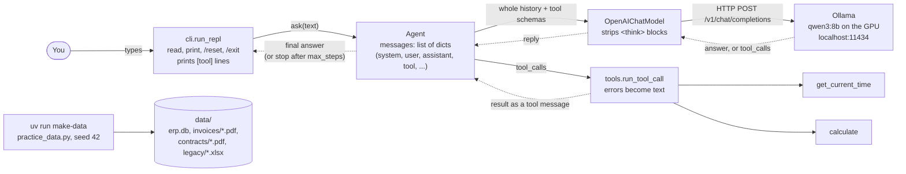

# Architecture

How the harness fits together right now. This diagram changes with every step.

`data/` is not connected to the agent yet. Steps 3b and 3c add the tools that read it.

The agent loops between the model and the tools until the model answers without asking for a tool, or until `max_steps` model calls are used up.

## What changed

- **Step 0:** Ollama runs the model locally. No harness code yet, only settings (`config.py`) that say where the model is.
- **Step 1:** The chat loop. `Agent` keeps the history and sends all of it on every call. `OpenAIChatModel` is the only part that knows about HTTP. The CLI catches connection errors, so a stopped Ollama gives a hint instead of a crash.
- **Step 2:** Tools. The agent sends tool schemas with each call. When the model replies with `tool_calls`, the agent runs them through `run_tool_call` and appends each result as a `tool` message, then calls the model again. Mistakes come back to the model as `Error: ...` text. `max_steps` stops endless loops.
- **Step 3a:** Practice data. `uv run make-data` writes a fake ERP database, invoice PDFs, a contract PDF and a messy Excel export into `data/`. Nothing reads it yet.
