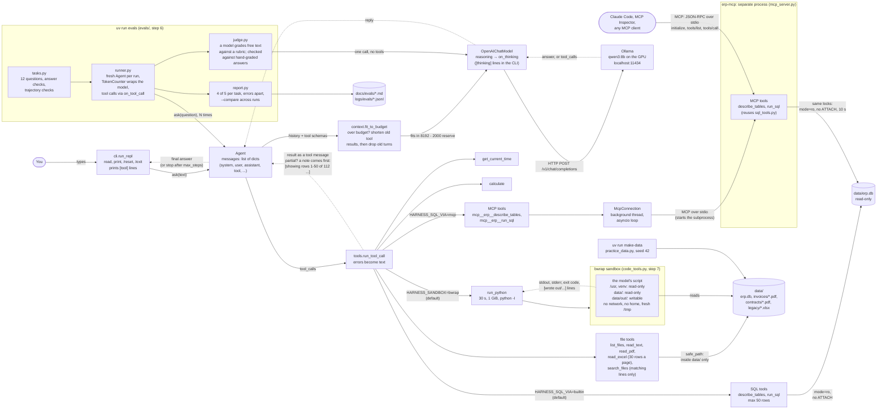

# Architecture

How the harness fits together right now. This diagram changes with every step.

The file tools read the files in `data/`. The SQL tools read `erp.db`, and the database itself refuses every write. They reach the database one of two ways: built in, inside the harness process, or through the `erp-mcp` server, which the harness starts as a subprocess. To the agent, both look like normal tools.

The agent loops between the model and the tools until the model answers without asking for a tool, or until `max_steps` model calls are used up.

`run_python` runs a script the model wrote, as a separate process. By default the process lives in a bubblewrap sandbox that shows it the data folder read-only, one writable folder for results, and no network. `HARNESS_SANDBOX=none` runs it without the sandbox (for the step 7 lesson), `off` removes the tool.

The evals sit on top of all of this and change none of it. The runner builds the same agent the CLI builds, asks each question N times on a fresh agent, and measures from the outside: tool calls through the `on_tool_call` hook, tokens by wrapping the model.

## What changed

- **Step 0:** Ollama runs the model locally. No harness code yet, only settings (`config.py`) that say where the model is.
- **Step 1:** The chat loop. `Agent` keeps the history and sends all of it on every call. `OpenAIChatModel` is the only part that knows about HTTP. The CLI catches connection errors, so a stopped Ollama gives a hint instead of a crash.
- **Step 2:** Tools. The agent sends tool schemas with each call. When the model replies with `tool_calls`, the agent runs them through `run_tool_call` and appends each result as a `tool` message, then calls the model again. Mistakes come back to the model as `Error: ...` text. `max_steps` stops endless loops.
- **Step 3a:** Practice data. `uv run make-data` writes a fake ERP database, invoice PDFs, a contract PDF and a messy Excel export into `data/`. Nothing reads it yet.
- **Step 3b:** File tools. Four tools read text, PDF and Excel files. Every path goes through `safe_path`, so nothing outside `data/` can be opened. `run_tool_call` now cuts every result to 3000 characters, so one big file can't fill the context.
- **Step 3c:** SQL tools. `describe_tables` shows the table layout, `run_sql` runs one query. The database is opened read-only and can't attach other files, so writes fail inside SQLite itself. Results stop at 50 rows.
- **Step 4a:** An MCP server, `erp-mcp`. It offers the same two SQL tools to any MCP client, as a separate program talking JSON-RPC over stdin/stdout. Our harness doesn't use it yet.
- **Step 4b:** The harness as an MCP client. With `HARNESS_SQL_VIA=mcp` it starts `erp-mcp`, asks for its tools, and wraps each one as a normal `Tool` named `mcp__erp__<tool>`. `McpConnection` runs the async MCP client on a background thread, so the rest of the harness stays synchronous. The agent loop didn't change.
- **Step 5a:** Partial results say so first. `run_sql` counts every row and starts a cut result with `[showing rows 1-50 of 112 ...]`. `cap_output` (the 3000-character safety net) also puts its note at the top.
- **Step 5b:** `read_excel` returns 30 rows at a time and says which `start_row` to call next. `max_rows` can't go above the page size.
- **Step 5c:** `search_files` finds a word across text, PDF and Excel files and returns only the matching lines, each with its file and page or row. The model can search five PDFs in one call instead of reading them one by one.
- **Step 5d:** `context.py` estimates the size of each request (characters ÷ 4) and trims it to fit before every model call: old tool results become one-line stubs, then whole old turns are dropped. The newest turn and the system prompt always stay. The CLI shows `[context ~N of 8192 tokens]` after each answer.
- **Step 6:** Evals. `uv run evals` runs twelve questions over the practice data N times each and writes a report: `4 of 5` per task, a trajectory column for what the agent did (did it read all five PDFs?), errors counted apart from wrong answers, and the first failed answer quoted. A model judge grades the free-text task against a rubric, and is checked against six hand-graded answers first. `--compare` puts several runs side by side, one variable per run: model, prompt, context window, commit.
- **Step 7:** `run_python`. The model writes a short script; the harness runs it with the data folder as its working directory, under a 30-second and 1 GiB limit, and returns what it printed and wrote to `data/out/`. 7a ran it as a plain subprocess and showed the script listing the home folder and writing outside the data folder. 7b runs it inside `bwrap`: `/usr`, the venv and `data/` read-only, `data/out/` writable, no network, no home. The same scripts now fail. The model cannot choose the mode: the tool's only argument is the code.
