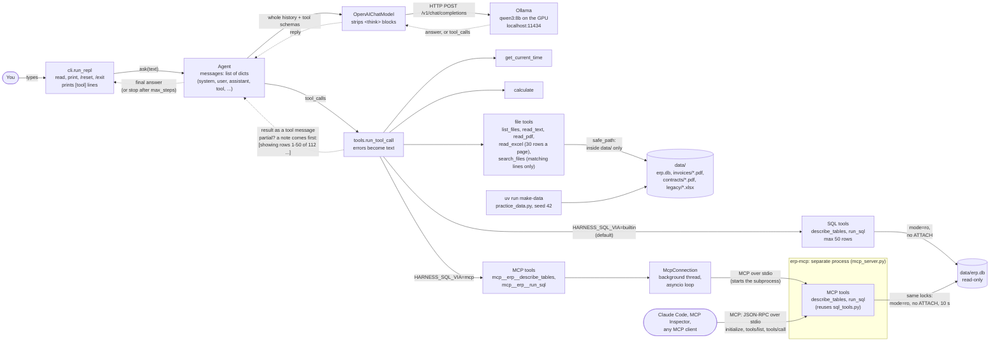

# Architecture

How the harness fits together right now. This diagram changes with every step.

The file tools read the files in `data/`. The SQL tools read `erp.db`, and the database itself refuses every write. They reach the database one of two ways: built in, inside the harness process, or through the `erp-mcp` server, which the harness starts as a subprocess. To the agent, both look like normal tools.

The agent loops between the model and the tools until the model answers without asking for a tool, or until `max_steps` model calls are used up.

## What changed

- **Step 0:** Ollama runs the model locally. No harness code yet, only settings (`config.py`) that say where the model is.
- **Step 1:** The chat loop. `Agent` keeps the history and sends all of it on every call. `OpenAIChatModel` is the only part that knows about HTTP. The CLI catches connection errors, so a stopped Ollama gives a hint instead of a crash.
- **Step 2:** Tools. The agent sends tool schemas with each call. When the model replies with `tool_calls`, the agent runs them through `run_tool_call` and appends each result as a `tool` message, then calls the model again. Mistakes come back to the model as `Error: ...` text. `max_steps` stops endless loops.
- **Step 3a:** Practice data. `uv run make-data` writes a fake ERP database, invoice PDFs, a contract PDF and a messy Excel export into `data/`. Nothing reads it yet.
- **Step 3b:** File tools. Four tools read text, PDF and Excel files. Every path goes through `safe_path`, so nothing outside `data/` can be opened. `run_tool_call` now cuts every result to 3000 characters, so one big file can't fill the context.
- **Step 3c:** SQL tools. `describe_tables` shows the table layout, `run_sql` runs one query. The database is opened read-only and can't attach other files, so writes fail inside SQLite itself. Results stop at 50 rows.
- **Step 4a:** An MCP server, `erp-mcp`. It offers the same two SQL tools to any MCP client, as a separate program talking JSON-RPC over stdin/stdout. Our harness doesn't use it yet.
- **Step 4b:** The harness as an MCP client. With `HARNESS_SQL_VIA=mcp` it starts `erp-mcp`, asks for its tools, and wraps each one as a normal `Tool` named `mcp__erp__<tool>`. `McpConnection` runs the async MCP client on a background thread, so the rest of the harness stays synchronous. The agent loop didn't change.
- **Step 5a:** Partial results say so first. `run_sql` counts every row and starts a cut result with `[showing rows 1-50 of 112 ...]`. `cap_output` (the 3000-character safety net) also puts its note at the top.
- **Step 5b:** `read_excel` returns 30 rows at a time and says which `start_row` to call next. `max_rows` can't go above the page size.
- **Step 5c:** `search_files` finds a word across text, PDF and Excel files and returns only the matching lines, each with its file and page or row. The model can search five PDFs in one call instead of reading them one by one.
