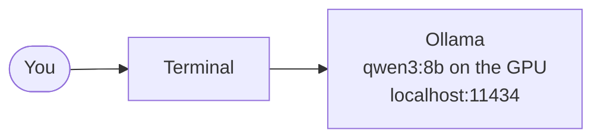

# Architecture

How the harness fits together right now. This diagram changes with every step.

## What changed

- **Step 0:** Ollama runs the model locally. No harness code yet, only settings (`config.py`) that say where the model is.
