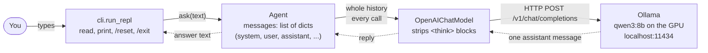

# Architecture

How the harness fits together right now. This diagram changes with every step.

## What changed

- **Step 0:** Ollama runs the model locally. No harness code yet, only settings (`config.py`) that say where the model is.
- **Step 1:** The chat loop. `Agent` keeps the history and sends all of it on every call. `OpenAIChatModel` is the only part that knows about HTTP. The CLI catches connection errors, so a stopped Ollama gives a hint instead of a crash.
